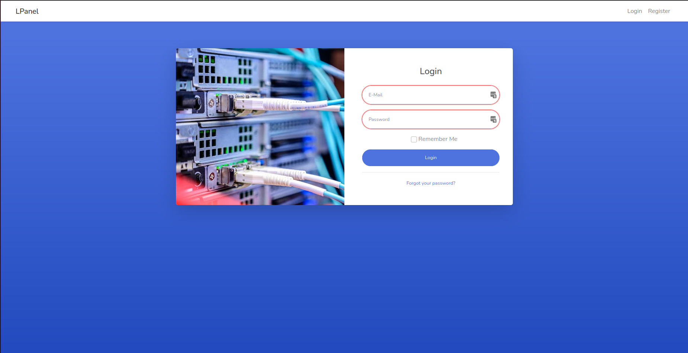
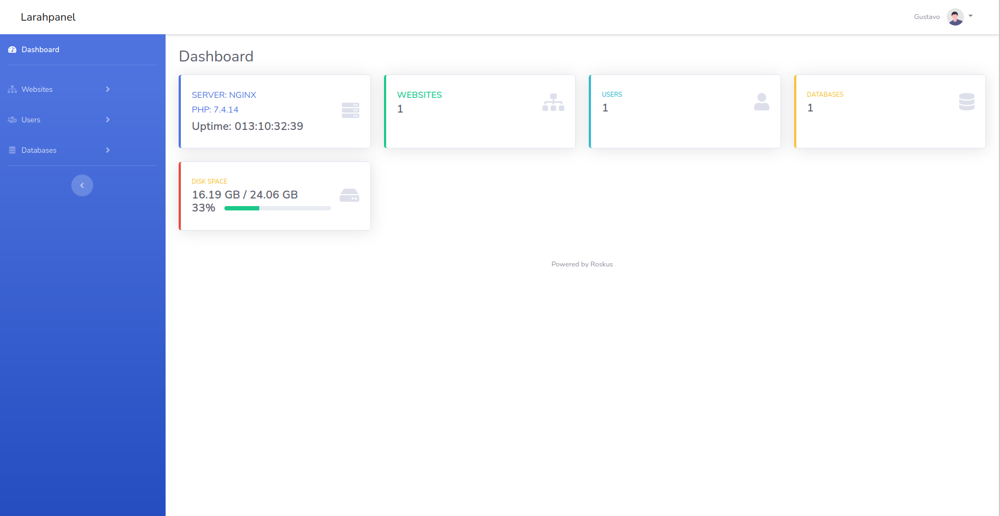

# LPanel: Web Hosting Panel

Open Source web hosting panel based in Laravel

[](https://github.com/Roskus/lpanel/actions/workflows/laravel.yml)

### Login


### Dashboard


## Features

* Virtual Host administration
  * Nginx
  * Apache (sites are listed only, creating a virtual host is not supported yet)
* Database administration
  * MariaDB / MySQL
  * Postgres
* Linux user administration

## Requirements

* Docker with Docker Compose
* Make
* PHP 8.4 or higher and Composer
* OpenSSL

## Setup

Clone project
```terminal
git clone git@github.com:Roskus/lpanel.git
cd lpanel
```

Create the `.env` file, docker compose reads the database name from it
```terminal
make env
```

Generate the self-signed SSL certificate, it is not stored in the repository and nginx needs it to start
```terminal
make cert
```

The `php` container runs nginx and php-fpm together with supervisord, like in a real server. Start the containers. Ports 80 and 443 must be free, stop any webserver running in the host first
```terminal
make build
```

Give php-fpm write access to its folders, the containers must be running
```terminal
make permissions
```

Install the application
```terminal
make install
```

`make install` asks before overwriting an existing `.env`, answer `n` to keep it. If you answer `y` a copy is saved in `.env.backup`.

Create the first panel user
```terminal
docker compose exec php php artisan panel:user:create
```

Open https://lpanel.localhost and accept the browser warning for the self-signed certificate.

## Make

Run `make` to list the available commands

| Command        | Description                                          |
|----------------|------------------------------------------------------|
| `make help`    | List the available commands                          |
| `make env`     | Create .env, asks before overwriting an existing one |
| `make install` | Install the application                              |
| `make up`      | Start and run the application                        |
| `make build`   | Build and start                                      |
| `make ssh`     | Connect into php container                           |
| `make cert`    | Generate a self-signed SSL certificate               |
| `make permissions` | Fix the folders php-fpm writes to, the containers must be running |

The certificate is created for `localhost` by default, use `make cert SSL_DOMAIN=example.localhost SSL_DAYS=365` to change it.
Nginx loads `localhost.crt` and `localhost.key`, update `infrastructure/etc/nginx/default.conf` and `static.conf` when you use another domain.

## Commands

Run the commands inside the php container, `make ssh`, because the database host `db` only resolves there.

### User panel create

```terminal
php artisan panel:user:create
```

### Create a website virtual host by default create a nginx virtualhost

```terminal
php artisan panel:website:create domain.com
```

### Create a website virtual host with a specific PHP version

By default uses the running PHP version

```terminal
php artisan panel:website:create domain.com nginx 8.4
```

The virtual host uses the socket `/var/run/php/php8.4-fpm.sock`, that version must be installed in the server. The docker image only has PHP 8.5, any other version returns a 502 error.

The virtual host is written to `sites-available` and enabled in `sites-enabled`, or to `conf.d` when the server does not have `sites-available`. The base path is `/etc`, set `WEBSERVER_PATH` to change it. The website directory is created in `/var/www/domain.com/public`, set `WEBSITES_PATH` to change the base path, existing files are kept. A basic `index.php` with a welcome message is added when the website has no index.

Websites listen on HTTPS when `WEBSITE_SSL_CERTIFICATE` and `WEBSITE_SSL_CERTIFICATE_KEY` are set, otherwise only on HTTP. Docker uses the certificate from `make cert`. The configuration is checked with `nginx -t` and nginx is reloaded, if the check fails the previous state is restored.

> **Warning:** this flow is only meant for the docker environment. Outside docker do not give `www-data` sudo access to nginx while it can write the nginx configuration: PHP code from any hosted website could use it to get root access.

### Disable or enable a website

Removes or adds the link in `sites-enabled` and reloads nginx, the virtual host stays in `sites-available`. Also available in the websites list. It needs `sites-available`, servers that only use `conf.d` are not supported.

```terminal
php artisan panel:website:disable domain.com
php artisan panel:website:enable domain.com
```

### Create a database in MariaDB / MySQL

```terminal
php artisan panel:database:create dbname
```

### Create a database user

```terminal
php artisan panel:database:user-create username dbname
```

### Create a linux user

```terminal
php artisan panel:linux:user-create
```

## Tests

Run tests, they use an in-memory SQLite database
```terminal
php artisan test
```

## Made with ❤️

#### Design based in StartBootstrap

https://github.com/startbootstrap/startbootstrap-sb-admin-2

#### Login photo by Brett Sayles

https://www.pexels.com/photo/white-and-blue-cables-2881233

#### TLD list

https://data.iana.org/TLD/tlds-alpha-by-domain.txt
